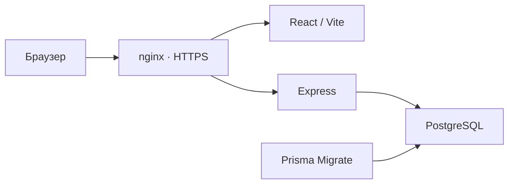
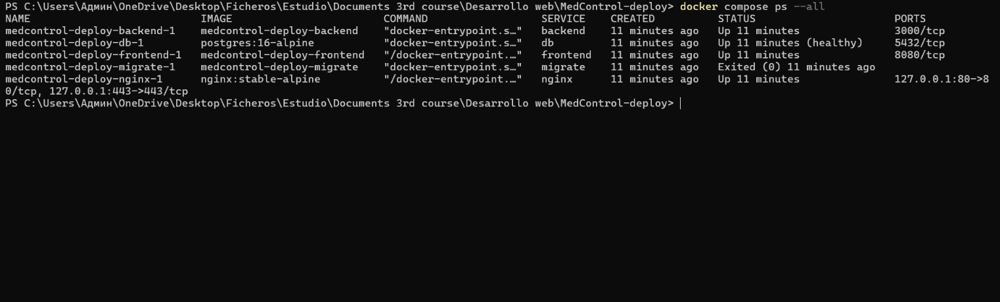
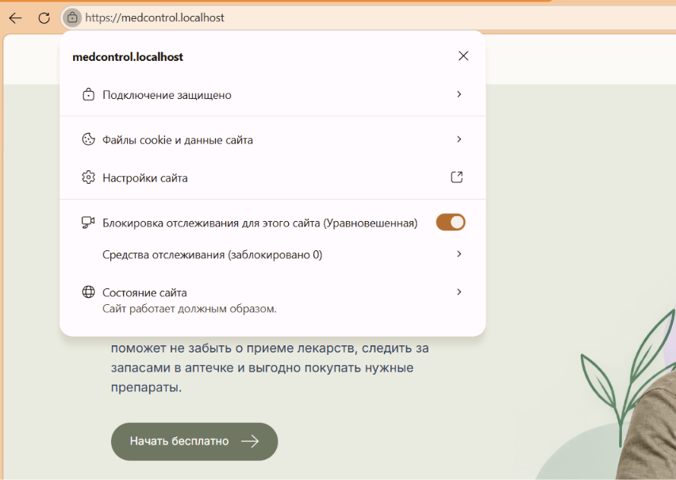
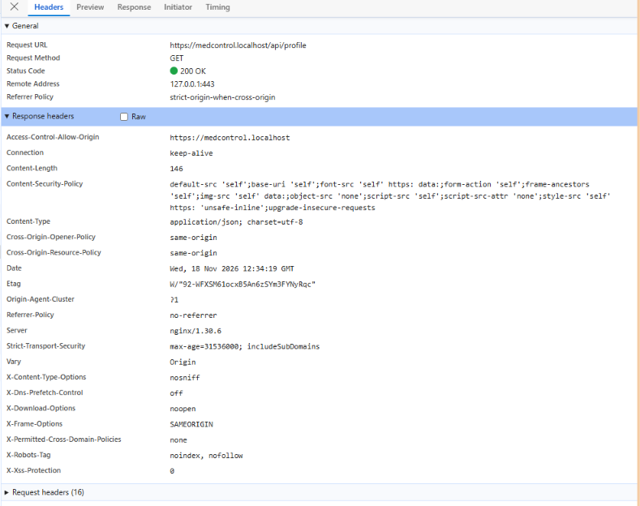
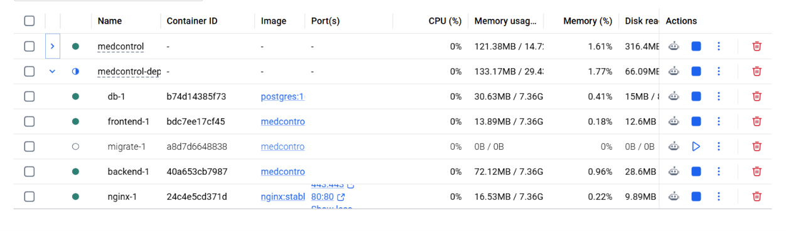

# Локальный деплой MedControl

Браузер открывает `https://medcontrol.localhost`. Входной nginx направляет страницы во фронтенд, а запросы к `/api/` — в Express. Express обращается к PostgreSQL через Prisma. При запуске сервис `migrate` применяет миграции и завершается.



| Сервис | Технология | Внутренний порт | Запуск |
|---|---|---|---|
| nginx | nginx | 80, 443 | Обратный прокси с HTTPS |
| frontend | React, Vite | 8080 | nginx раздаёт сборку |
| backend | Node.js, Express, Prisma | 3000 | `npm start` |
| db | PostgreSQL | 5432 | PostgreSQL с постоянным томом |
| migrate | Prisma Migrate | — | `prisma migrate deploy` |

Наружу проброшены только порты входного nginx, привязанные к `127.0.0.1`.

## Переменные окружения

- `PROJECT_DIR` — путь от папки деплоя к репозиторию.
- `POSTGRES_PASSWORD`, `JWT_SECRET` — секреты в локальном `.env`.
- `DATABASE_URL` — адрес PostgreSQL внутри Compose.
- `PORT`, `CLIENT_URL`, `NODE_ENV` — параметры бэкенда.
- `VITE_API_URL` — публичный адрес API для сборки фронтенда.

## Подготовка и запуск

Размещаю репозиторий приложения `MedControl` и репозиторий конфигурации `MedControl-deploy` рядом, в общей папке. В `MedControl/deploy/` храню этот отчёт и скриншоты. Docker Compose запускаю из отдельной папки `MedControl-deploy`, где лежат `docker-compose.yml`, `nginx.conf` и `init-local.ps1`.

При первом запуске открываю Docker Desktop, проверяю, что в PowerShell доступен `mkcert`, и из папки `MedControl-deploy` выполняю команды ниже. Для этой структуры использую `PROJECT_DIR=../MedControl`. Если папка приложения называется иначе, меняю путь в локальном `.env` перед запуском Compose.

```powershell
mkcert -version
powershell -ExecutionPolicy Bypass -File .\init-local.ps1
docker compose up --build -d
docker compose ps --all
```

Скрипт подготавливает локальный `.env` и сертификат для HTTPS. Фронтенд собирается с адресом API `/api`, поэтому браузер обращается к API на том же домене, на котором открыто приложение. Локальный `.env` и каталог `certs/` храню на компьютере.

Для повторного запуска существующей сборки использую `docker compose up -d`. После изменений в коде запускаю `docker compose up --build -d`. Для остановки использую `docker compose down`, чтобы сохранить данные в томе PostgreSQL.

## Проверка деплоя

1. Выполняю `docker compose ps --all`. Проверяю, что база данных в состоянии `healthy`, сервисы `nginx`, `frontend` и `backend` запущены, а одноразовый `migrate` завершился с кодом `0`.

   

2. Открываю [medcontrol.localhost](https://medcontrol.localhost) по HTTPS, регистрирую тестовую учётную запись и вхожу в приложение.

   

3. Открываю личный кабинет и во вкладке Network проверяю запрос `GET https://medcontrol.localhost/api/profile`. В заголовках вижу статус `200 OK` и адрес `127.0.0.1:443`.

   

4. Открываю Docker Desktop и проверяю контейнеры в группе `medcontrol-deploy` и опубликованные порты nginx.

   

## Ошибки при запуске

| Что произошло | Как устранила |
|---|---|
| Сборка прервалась при загрузке образа nginx с Docker Hub. Docker не смог разрешить имя `registry-1.docker.io`. | Повторила сборку. При повторной попытке образ загрузился, и контейнеры запустились. |
| Форма регистрации отправляла запрос на `http://localhost:3001/api/auth/register`. На странице деплоя регистрация завершалась ошибкой подключения. | Перевела фронтенд на адрес API `/api` и пересобрала контейнер фронтенда. После этого регистрация и вход прошли успешно. |

## GitHub Actions

Результат сборки образов проверяю во вкладке **Actions** основного репозитория после отправки изменений на GitHub. Само приложение запускаю локально через Docker Compose. Адрес `medcontrol.localhost` доступен на компьютере, где запущен деплой.
